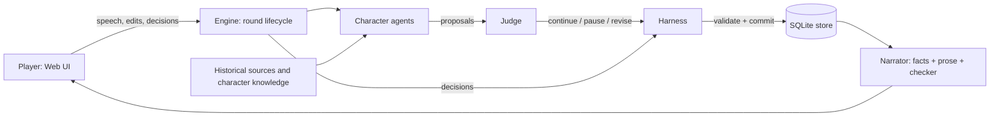

# The Jinyang Pact

A controllable multi-agent historical narrative system (NUS DSA4213, Group 21).

Jinyang, summer 936. Shi Jingtang, besieged by the Later Tang emperor Li Congke, seeks help from the Khitan ruler Yelü Deguang. Five language-model characters (Shi Jingtang, Sang Weihan, Liu Zhiyuan, Yelü Deguang, Li Congke) deliberate, draft, negotiate and act.

The player is a secretary in Shi's headquarters who speaks to the council, edits the draft and is consulted before consequential decisions take effect.

The guiding principle is **"Agent proposes, Harness disposes"**: characters propose actions; a deterministic Harness validates permissions, prerequisites and resources, pauses for the player where a decision is consequential, and is the only component that can change the world state. A Judge flags proposals needing the player's attention, and the narrator describes only events that were actually committed.

## Architecture



- **World state:** Versioned and hashed. State changes are committed as events, supporting deterministic replay and re-derivation.
- **Knowledge isolation:** Each character receives only information they have witnessed or been told. Secret treaty clauses remain restricted to their holders.
- **Pauses:** Mandatory checkpoints and Judge-flagged semantic decisions present player-visible facts and feasible options, including endorse, withhold, amend, delegate and ask.
- **Multi-agent interaction:** Characters can exchange questions and responses within the same world round. Pending interactions, waiting conditions and action feedback are tracked for later activation.
- **Narration:** A deterministic fact header records committed events. An LLM adds atmospheric prose, subject to consistency checks and fallback handling.
- **Experimental modes:** `full` (Harness + Judge), `no_judge` (Harness without Judge) and `baseline` (prompt-only control with permissive commits).

For further details, see [Interaction Architecture](docs/INTERACTION_ARCHITECTURE.md).

## Repository Map

| Path | Contents |
|---|---|
| `content/` | Historical scenario, five characters, sources, experimental cases C1–C6, development cases D1–D3, pilot cases P1–P3 and traces |
| `src/core/` | Domain model, actions, rules, negotiation, knowledge, world state and terminal conditions |
| `src/store/` | SQLite persistence, event records, snapshots and usage data |
| `src/harness/` | Action validation, commits, pauses, decisions, recovery and replay |
| `src/llm/` | OpenRouter and mock clients, structured outputs, budget control, redaction and usage tracking |
| `src/agents/` | Character agents, Judge, mapper, narrator, prompts and mock personas |
| `src/engine/` | Round lifecycle, scheduling, interaction management, decision policies and sessions |
| `src/eval/` | Experiment execution, independent oracle, metrics, reports and human evaluation |
| `src/server/` | Game server and API |
| `web/` | React-based web interface |
| `src/cli/` | Experiment, smoke test, report, reconciliation, packaging and human-evaluation commands |
| `tests/` | Automated tests using mock LLMs and offline fixtures |
| `docs/` | Selected architecture, experiment-running and demonstration documentation |

## Requirements

- Node.js ≥ 22.13
- npm
- Git (for cloning the repository)

The system uses Node.js, TypeScript, React and SQLite.

## Installation

Clone the repository and install dependencies:

```bash
git clone https://github.com/leisure-cloud05/jinyang-pact.git
cd jinyang-pact
npm ci
```

Verify the installation:

```bash
npm run typecheck
npm test
npm run build
```

**Windows note:** If PowerShell prevents execution of `npm` because of its execution policy, use `npm.cmd` instead.

## Quick Start — Mock LLM

Mock mode is intended for offline pipeline validation and does not require an API key.

### Option 1: Development web server

```bash
npm run play:web
```

Open the local URL displayed in the terminal.

### Option 2: Build and start the game server

```bash
npm run play:web:build
npm run play:server
```

Open `http://127.0.0.1:8787` unless the server reports another address.

The web interface allows users to explore historical scenarios, interact with characters, edit diplomatic terms, review decisions and advance the narrative.

Mock characters are deterministic test implementations. Their behavior should not be interpreted as evidence of real LLM capabilities.

## Live Model — OpenRouter

Live model calls require both:

1. `LLM_PROVIDER=openrouter` and `OPENROUTER_API_KEY` configured in `.env`.
2. The explicit `--live` flag.

Copy `.env.example` to `.env` and configure the required environment variables.

**Never commit `.env` or share API keys.** The `.env` file is excluded from Git.

Commands:

```bash
npm run live:smoke -- --live
npm run play:server -- --live
```

The first command checks model integration. The second starts the game server with live model calls.

For detailed configuration and execution instructions, see [Live Runbook](docs/LIVE_RUNBOOK.md).

## Experiments and Evaluation

The project supports three experimental configurations:

| Configuration | Description |
|---|---|
| `baseline` | Prompt-only control with permissive commits |
| `no_judge` | Deterministic Harness without Judge |
| `full` | Deterministic Harness with Judge |

The main evaluation uses six cases (C1–C6), three configurations and two repetitions, giving **36 planned runs**.

### Experiment Commands

```bash
# Development pipeline validation (mock)
npm run exp -- --plan dev

# Pilot experiments with live models
npm run exp -- --plan pilot --live

# Freeze experimental configuration
npm run exp -- --freeze

# Main experiment with live models
npm run exp -- --plan main --live
```

The main live experiment requires a matching `runs/freeze.json`.

### Reports and Analysis

```bash
# Reconcile actual API costs
npm run reconcile -- <experiment-dir> --live

# Generate metrics, tables and figures
npm run report -- <experiment-dir>

# Generate human-evaluation packets
npm run humaneval:packets -- <experiment-dir>

# Calculate inter-rater agreement
npm run humaneval:agreement -- <ratings-dir> --key <key-file>

# Package results with sensitive-data filtering
npm run pack -- <experiment-dir>
```

Mock experiments are explicitly labelled **"PIPELINE VALIDATION (mock LLM) — not findings"**.

They validate experiment execution and reporting but are not evidence of real model performance.

The evaluation pipeline includes an independent oracle, hard-rule checks, critical-pause metrics, completion measures, replay consistency checks, leakage detection, efficiency measurements and human evaluation.

## Testing

Run the offline test suite:

```bash
npm test
```

Run TypeScript checks:

```bash
npm run typecheck
```

Build the web interface:

```bash
npm run build
```

The tests cover character behavior, rule enforcement, engine lifecycle, Harness decisions, LLM parsing, persistence, API behavior and evaluation components.

## Documentation

| Document | Purpose |
|---|---|
| [Interaction Architecture](docs/INTERACTION_ARCHITECTURE.md) | Multi-agent interaction, scheduling, pending work and recovery mechanisms |
| [Live Runbook](docs/LIVE_RUNBOOK.md) | Live model configuration, experiment execution and reproducibility |
| [Demo Script](docs/demo_script.md) | Demonstration walkthrough and presentation guidance |

Internal development notes, code-review histories, old proposals and team coordination documents are maintained separately from the public project repository.

## Notes

- Live and mock experiments must be distinguished when interpreting results.
- The independent oracle evaluates committed actions separately from the Harness implementation.
- The deterministic Harness is responsible for validated world-state changes.
- Interactive gameplay and formal experiments serve different purposes.
- Local runtime databases, generated reports and other temporary outputs are excluded from Git by default.