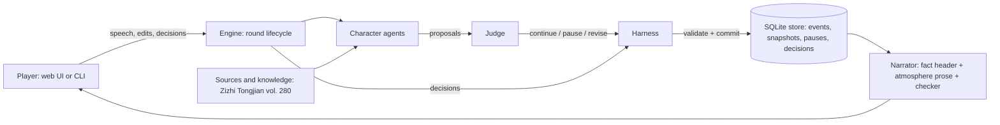

# The Jinyang Pact

A controllable multi-agent historical narrative system (NUS DSA4213, Group 21).

Jinyang, summer 936. Shi Jingtang, besieged by the Later Tang emperor Li Congke, seeks help from the Khitan ruler
Yelü Deguang. Five language-model characters (Shi Jingtang, Sang Weihan, Liu Zhiyuan, Yelü Deguang, Li Congke)
deliberate, draft, negotiate and act. The player is a secretary in Shi's headquarters who speaks to the council,
edits the draft and is asked before consequential decisions take effect.

The guiding principle is **"Agent proposes, harness disposes"**: characters only *propose* actions; a deterministic
Harness validates permissions, prerequisites and resources, pauses for the player where a decision is
consequential, and is the only component that can change the world state. A Judge flags proposals that need the
player's attention, and the narrator describes only events that were actually committed.

## Architecture



- **World state** is versioned and hashed; every change is an event committed in one transaction, so runs can be
  replayed and re-derived exactly.
- **Knowledge isolation**: each character's context is built only from what that character has witnessed or been
  told (structured assertions with evidence); secret treaty clauses are visible only to their holders.
- **Pauses**: mandatory checkpoints (dispatching the request, major commitments, mutiny, negotiation deadlock) and
  Judge-flagged semantic ones present player-visible facts and feasible options (endorse, withhold, amend, delegate,
  ask, …). Asking a question gets an in-character answer from a player-visible context only.
- **Narration**: a deterministic header states every committed fact; the model adds atmosphere-only prose, which a
  conservative checker replaces with template prose on any name, number, outcome or treaty term.
- **Modes**: `full` (Harness + Judge), `no_judge` (ablation), `baseline` (prompt-only control, permissive commits).

## Repository map

| path | contents |
|---|---|
| `PLAN.md` | the implementation contract (rules H01–H16, game rules G01–G12, lifecycle, evaluation design) |
| `content/` | scenario, five characters, sources (40 verbatim entries), cases C1–C6, dev D1–D3, pilot P1–P3, traces |
| `src/core/` | pure domain model: actions, rules, negotiation, siege, knowledge, terminal conditions, projection |
| `src/store/`, `src/harness/` | SQLite store with a single-writer lock; commit, validation, pauses, decisions, recovery, replay |
| `src/llm/` | OpenRouter and mock clients, strict JSON-schema outputs, budget reservations, redaction, usage |
| `src/agents/` | character, Judge, mapper, narrator and answer roles; prompts; narration checker; mock personas |
| `src/engine/` | round lifecycle, scene scheduler, decision policies, sessions, crash-safe runner |
| `src/eval/` | experiment runner, independent oracle, checkpoint detectors, metrics, reports, human-eval packets |
| `src/server/`, `web/` | play server (Fastify, 127.0.0.1 only) and React UI |
| `src/cli/` | `play`, `smoke`, `exp`, `report`, `reconcile`, `pack`, `humaneval` |
| `tests/` | vitest suites (no network; mock LLM only) |
| `docs/` | handoff, next steps, team guide, known issues, demo script, report draft, review log, proposal |

## Setup (Windows)

Requires Node.js ≥ 22.13 (developed on Node 24, which provides `node:sqlite`) and Git.

In PowerShell, if `npm` is refused because running scripts is disabled (execution policy), type `npm.cmd`
instead of `npm` in every command below (or use Command Prompt).

```powershell
# in each new PowerShell window, if node/npm are not found:
$env:PATH = [Environment]::GetEnvironmentVariable('PATH','Machine') + ';' + [Environment]::GetEnvironmentVariable('PATH','User')
npm install
npm run typecheck
npm test
```

## Quick start (offline, mock LLM)

Everything below runs without an API key or network access.

```powershell
npm run play:web:build
npm run play:server          # then open http://127.0.0.1:8787
```

## Live model (OpenRouter)

Live calls need **both** `LLM_PROVIDER=openrouter` with `OPENROUTER_API_KEY` in `.env` (copy `.env.example`) **and**
the explicit `--live` flag. `.env` is gitignored; never commit or share it. Every log and output file redacts the
key. Step-by-step instructions: [`docs/NEXT_STEPS.md`](docs/NEXT_STEPS.md).

```powershell
npm run live:smoke -- --live         # gate: 12 calls across the four roles
npm run play:server -- --live        # play with the real model
```

## Experiments and evaluation

```powershell
npm run exp -- --plan dev            # D1–D3, mock (pipeline validation)
npm run exp -- --plan pilot --live   # D1–D3 + P1–P3 only (tuning)
npm run exp -- --freeze              # writes runs/freeze.json
npm run exp -- --plan main --live    # C1–C6 × 3 modes × 2 reps = 36 runs; refuses without a matching freeze
npm run reconcile -- <dir> --live    # reconcile costs from OpenRouter generation records
npm run report -- <dir>              # metrics, tables and SVG figures in <dir>/report/
npm run humaneval:packets -- <dir>   # 18 blind packets in <dir>/humaneval/, key in <dir>/humaneval-key/
npm run humaneval:agreement -- <ratings dir> --key <key file>
npm run pack -- <dir>                # shareable ZIP without .env, keys or raw database files
```

`npm run exp` without `--live` runs the mock personas, and every run records its provider: `exp` and `report`
label mock experiments **"PIPELINE VALIDATION (mock LLM) — not findings"** (`report` follows each run's recorded
provider and takes no `--live` flag; a mixed set is refused). Build human-evaluation packets only from live runs. For experiments, held-out cases C1–C6 can be run
live only under the `main` plan with a matching freeze, and tuning uses D1–D3 and P1–P3 only; interactive play
(`play`, `play:server`) is not an experiment and may use any configuration.

## Testing and review

`npm test` runs the full offline suite (programmatic hard-rule tests, engine end-to-end runs on all cases and
modes, oracle mutation tests, server API tests). The project also underwent independent model-assisted code reviews during development.
Detailed review records are retained separately from the repository.

## Documentation map

| file | for |
|---|---|
| [`docs/NEXT_STEPS.md`](docs/NEXT_STEPS.md) | checklist and exact commands for the live phase, evaluation and submission |
| [`docs/TEAM_GUIDE.md`](docs/TEAM_GUIDE.md) | 20-minute introduction for group members, with likely presentation questions |
| [`docs/KNOWN_ISSUES.md`](docs/KNOWN_ISSUES.md) | verified issues and experiment risks |
| [`docs/demo_script.md`](docs/demo_script.md) | one-minute and extended demonstration |
| [`docs/report/report.md`](docs/report/report.md) | final report draft (results pending) |
| [`PLAN.md`](PLAN.md) | full specification: rules, lifecycle, evaluation design |
| [`AGENT_START_HERE.md`](AGENT_START_HERE.md) | entry point for AI coding agents |
| [`docs/reference/proposal_text.md`](docs/reference/proposal_text.md) | the group proposal |
